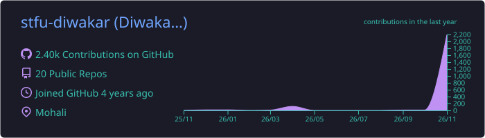
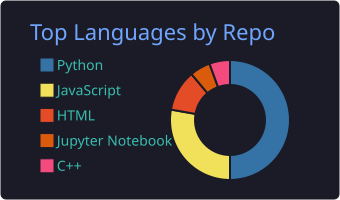
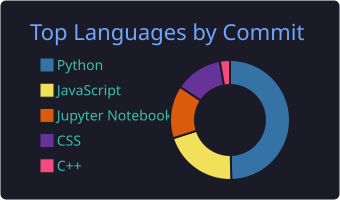
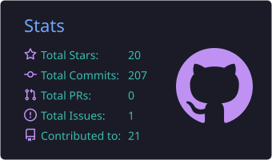
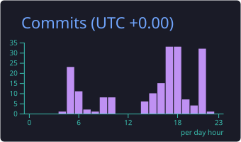

<!-- ═══════════════════════════════════════════════════════════ -->
<!--           DIWAKAR JHA · GITHUB PROFILE README             -->
<!-- ═══════════════════════════════════════════════════════════ -->

<div align="center">

<!-- HERO HEADER -->


<!-- TYPING ANIMATION -->
<a href="https://portfolio-bpd3.onrender.com/" target="_blank">
  
</a>

<br/>

<!-- STATUS BADGE -->


<br/><br/>

<!-- SOCIAL BADGES -->
<a href="https://portfolio-bpd3.onrender.com/" target="_blank">
  
</a>
<a href="https://linkedin.com/in/diwakar-jha-064130229" target="_blank">
  
</a>
<a href="mailto:diwakarjha42037@gmail.com">
  
</a>
<a href="https://instagram.com/stfu_diwakar" target="_blank">
  
</a>
<a href="https://quora.com/profile/Diwakar-Jha-133" target="_blank">
  
</a>

<br/><br/>

<!-- VIEWS + FOLLOWERS -->

&nbsp;


<br/>

<!-- SNAKE ANIMATION (generated by GitHub Action → output branch) -->
<picture>
  <source media="(prefers-color-scheme: dark)" srcset="https://raw.githubusercontent.com/stfu-diwakar/stfu-diwakar/output/github-snake-dark.svg" />
  <source media="(prefers-color-scheme: light)" srcset="https://raw.githubusercontent.com/stfu-diwakar/stfu-diwakar/output/github-snake.svg" />
  
</picture>

</div>

---

## 🧠 About Me

<table>
<tr>
<td width="52%" valign="top">

```jsonc
// diwakar.config.json
{
  "name"      : "Diwakar Jha",
  "pronouns"  : "he / him",
  "location"  : "Punjab, India  🇮🇳",
  "education" : "MCA (AI & ML) @ Chandigarh University",
  "focus"     : [
    "Machine Learning & Deep Learning",
    "Autonomous AI Agents & Generative AI",
    "Data Analytics & EDA"
  ],
  "building"  : [
    "Autonomous Research + Content Agent",
    "Python Data Analysis Desktop Suite",
    "AI-Powered Automation Pipelines"
  ],
  "philosophy": "build → break → learn → repeat",
  "status"    : "🟢 Available for Internships & Roles"
}
```

</td>
<td width="48%" valign="top">

### 🚀 Highlights

- 🎓 **MCA in AI & ML** — specialising in production-grade intelligent systems
- 🤖 Architecting **Autonomous AI Agents** with **Google Gemini API** & modern LLM toolchains
- 📊 Building end-to-end **Python EDA pipelines** that convert raw data into predictive signals
- ⚡ Engineering **event-driven automation workflows** via Make.com & REST APIs
- 🏢 Real-world industry simulations with **Tata Group** & **Deloitte Australia** (Forage)
- 🌐 **[Live Portfolio →](https://portfolio-bpd3.onrender.com/)**

<br/>

> *"The best way to understand intelligence is to build it."*

</td>
</tr>
</table>

---

## 🛠️ Tech Stack & Ecosystem

<div align="center">

### 💻 Languages


### 🤖 AI · ML · Data Science Tooling


</div>

| Layer | Technologies |
|:--|:--|
| **🧠 GenAI & LLMs** |     |
| **📐 Deep Learning** |    |
| **👁️ CV & NLP** |    |
| **📊 Data Science** |      |
| **⚙️ Frameworks** |     |
| **🔧 DevOps & Env** |     |

---

## 🧪 Featured Projects

| 🤖 Autonomous AI Research Agent | 📈 Python Data Studio | ⚡ AI Automation Pipelines |
|:--|:--|:--|
| A multi-step autonomous agent powered by **Google Gemini API** that ingests research sources, synthesises domain insights, and generates structured content — zero human prompt loops. | A fully-featured **Tkinter** desktop app for end-to-end EDA — dynamic charts, outlier detection, correlation heatmaps, and auto-generated statistical summaries. | Event-driven pipelines orchestrating **multi-step AI triggers**, webhook ingestion, real-time summarisation, and cloud sync via **Make.com** & Flask APIs. |
|    |    |    |
| `🟢 ACTIVE` | `🟢 ACTIVE` | `🟢 ACTIVE` |

---

## 💼 Experience & Industry Simulations

```
╔══════════════════════════════════════════════════════════════════════════════╗
║                       INDUSTRY EXPERIENCE TIMELINE                         ║
╠══════════════════════════════════════════════════════════════════════════════╣
║                                                                            ║
║  2025  ──▶  TATA GROUP  (Forage Virtual Experience)                        ║
║             ▸ Role    : Data Analytics Simulation Specialist               ║
║             ▸ Scope   : Enterprise dataset EDA using Python                ║
║             ▸ Outcome : C-suite ready analytics pipeline & metrics         ║
║             ▸ Tools   : Python · Pandas · Matplotlib · Seaborn             ║
║                                                                            ║
║  2025  ──▶  DELOITTE AUSTRALIA  (Forage Virtual Experience)                ║
║             ▸ Role    : Technology Consulting Simulation Analyst            ║
║             ▸ Scope   : Cloud Solution Architecture & Tech Roadmapping     ║
║             ▸ Outcome : Scalable infrastructure modernisation proposals    ║
║             ▸ Tools   : Cloud Architecture · Strategic Analysis            ║
║                                                                            ║
╚══════════════════════════════════════════════════════════════════════════════╝
```

---

## 📊 GitHub Analytics

<!-- ── Stats Cards: self-hosted via GitHub Action ── -->
<div align="center">

<a href="https://github.com/stfu-diwakar">
  
</a>

<br/>

<a href="https://github.com/stfu-diwakar">
  
</a>
<a href="https://github.com/stfu-diwakar">
  
</a>

<br/>

<a href="https://github.com/stfu-diwakar">
  
</a>
<a href="https://github.com/stfu-diwakar">
  
</a>

<br/><br/>

<!-- Streak: demolab.com works reliably -->
<a href="https://github.com/stfu-diwakar">
  
</a>

</div>

---

## 🏆 GitHub Trophies

<div align="center">

<a href="https://github.com/ryo-ma/github-profile-trophy">
  
</a>

</div>

---

## 🌐 Let's Connect

<div align="center">

<i>"Whether it's LLMs, ML pipelines, or the next autonomous AI product — my inbox is always open."</i>

<br/><br/>

<a href="https://portfolio-bpd3.onrender.com/" target="_blank">
  
</a>
<a href="https://linkedin.com/in/diwakar-jha-064130229" target="_blank">
  
</a>
<a href="mailto:diwakarjha42037@gmail.com">
  
</a>
<a href="https://instagram.com/stfu_diwakar" target="_blank">
  
</a>
<a href="https://quora.com/profile/Diwakar-Jha-133" target="_blank">
  
</a>

<br/><br/>

<sub>⚡ Crafted with passion from Punjab, India &nbsp;•&nbsp; <i>Diwakar Jha © 2025</i></sub>

</div>

<br/>

<!-- FOOTER WAVE -->

